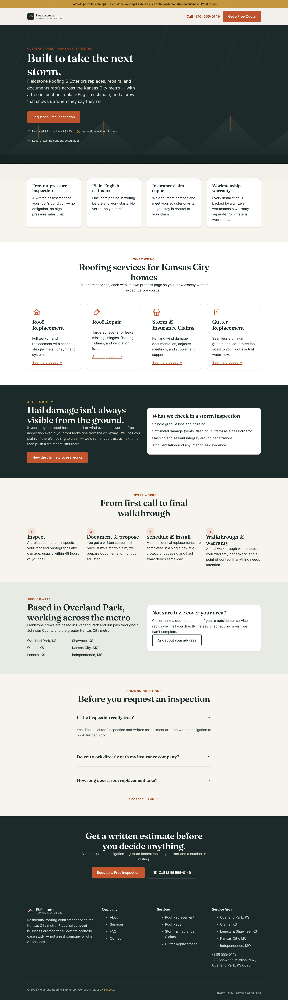
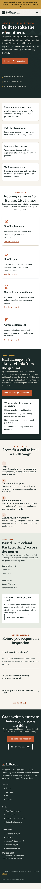
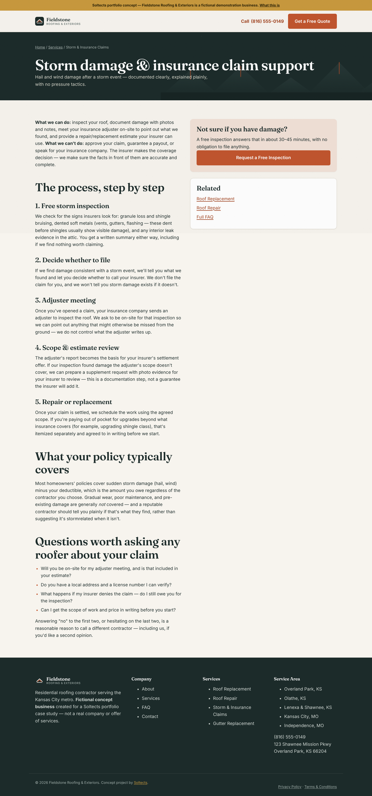
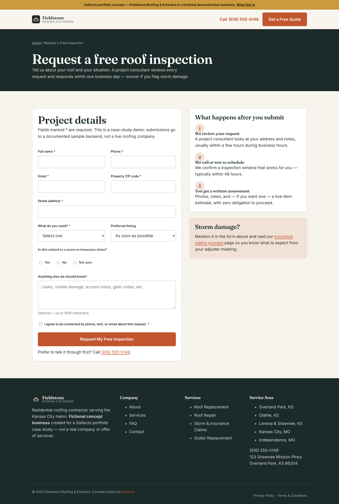

# Soltects Case Study 01 — Fieldstone Roofing & Exteriors

**A self-initiated Soltects portfolio project demonstrating full-service website work for the US
home-services market** — market research and industry selection, original brand and design
system, a complete 13-page responsive website, technical SEO, accessibility, and measured
performance testing, documented end-to-end as a professional case study.

> **Fieldstone Roofing & Exteriors is a fictional business.** It was created to demonstrate how
> Soltects researches, designs, and builds a site — not to claim a real client relationship, real
> leads, or real business results. See [`docs/case-study.md`](docs/case-study.md) §1, or the
> in-site disclosure at `site/about.html#concept` (also linked from the banner on every page).

**Live preview:** not yet deployed — see [`docs/10-deployment.md`](docs/10-deployment.md) for the
deployment plan, what's already built and ready, and the exact account-permission blocker holding
it up. This line will be updated with the real URL the moment a deployment exists.

## What this project demonstrates

| Area | Where |
|---|---|
| Market research & industry selection, with sourcing | [`docs/01-research.md`](docs/01-research.md) |
| Original brand identity & design system | [`docs/02-brand-strategy.md`](docs/02-brand-strategy.md) |
| UX/conversion-rate-optimization decisions, and why | [`docs/03-ux-conversion-strategy.md`](docs/03-ux-conversion-strategy.md) |
| Technical architecture (zero-build static site, demo backend) | [`docs/04-technical-architecture.md`](docs/04-technical-architecture.md) |
| Technical SEO implementation | [`docs/05-seo-implementation.md`](docs/05-seo-implementation.md) |
| Actual (not estimated) Lighthouse/accessibility/link/responsive test results | [`docs/06-testing-results.md`](docs/06-testing-results.md) |
| Asset licensing, including a transparently flagged blocked dependency | [`docs/07-asset-licensing.md`](docs/07-asset-licensing.md), [`08-photography-requirements.md`](docs/08-photography-requirements.md) |
| A pre-approval visual/functional audit that found and fixed 3 real bugs | [`docs/09-production-readiness-audit.md`](docs/09-production-readiness-audit.md) |
| Deployment plan and status | [`docs/10-deployment.md`](docs/10-deployment.md) |
| The full narrative case study (also exported as a 7-page PDF) | [`docs/case-study.md`](docs/case-study.md) / [`docs/case-study.pdf`](docs/case-study.pdf) |

## Screenshots

39 screenshots across all 13 pages × mobile/tablet/desktop live in [`/screenshots/`](screenshots/).
A few representative ones:

| Homepage (desktop) | Homepage (mobile) |
|---|---|
|  |  |

| Storm & insurance claims page | Quote request form |
|---|---|
|  |  |

## Demo forms vs. production lead capture

**No form on this site generates a real lead.** The Request-a-Free-Inspection and Contact forms
POST to a documented demo backend (`site/api/server.js` locally; `site/api/quote.js` /
`site/api/contact.js` as Vercel serverless functions once deployed) that validates input, rejects
obvious bots via a honeypot field, and logs the submission — it does not send an email, text, or
CRM notification, and nothing downstream follows up with anyone. This is stated on-page, in the
success message, in an `X-Fieldstone-Demo: true` response header, and in
[`docs/04-technical-architecture.md`](docs/04-technical-architecture.md) under "Demo backend
limitations." Full detail in [`docs/10-deployment.md`](docs/10-deployment.md).

## Running the site locally

```bash
cd site/api
node server.js
# → http://localhost:4173
```

No build step, no `npm install`, no external services required to run the full site and both demo
forms.

## Running the tests

```bash
# with the server above running in another terminal:
node tests/linkcheck.js http://localhost:4173
node tests/screenshots.js http://localhost:4173
```

Lighthouse results are documented (not just linked) in
[`docs/06-testing-results.md`](docs/06-testing-results.md). Once a real deployment exists, retarget
every canonical/OG/sitemap URL to it in one command:

```bash
node tests/set-canonical-domain.js https://<the-real-domain>
```

## Repository layout

```
docs/                 Research, strategy, architecture, testing, and the full case study (see table above)
site/                 The actual website (static HTML/CSS/JS, zero build step)
  api/server.js            Local dev server: static files + /api/quote and /api/contact
  api/quote.js, contact.js Vercel serverless function versions of the same endpoints
screenshots/          39 responsive screenshots (13 pages × 3 breakpoints)
tests/                Link checker, Playwright screenshot capture, Lighthouse-report tooling,
                       and the canonical-domain retargeting script
```

## Suggested repository topics

This repository doesn't have GitHub topics set yet (no tool in this session can set them — add via
the repo page's "⚙️" next to **About**, or Settings → General). Suggested set:

```
case-study  portfolio  web-design  responsive-design  accessibility  seo
conversion-rate-optimization  static-site  vanilla-javascript  ux-design
demo-project  roofing-website
```

## Stack

Static HTML/CSS/JS, no framework, no build step (see
[`docs/04-technical-architecture.md`](docs/04-technical-architecture.md) for why). Fonts: Fraunces
+ Inter via Google Fonts. Testing: Google Lighthouse, Playwright (Chromium), a custom link checker.
Deployment target: Vercel (see [`docs/10-deployment.md`](docs/10-deployment.md)).
